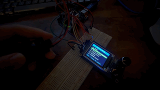
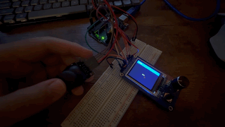
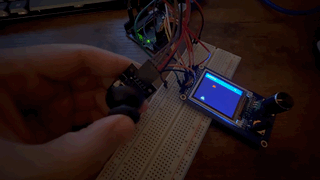
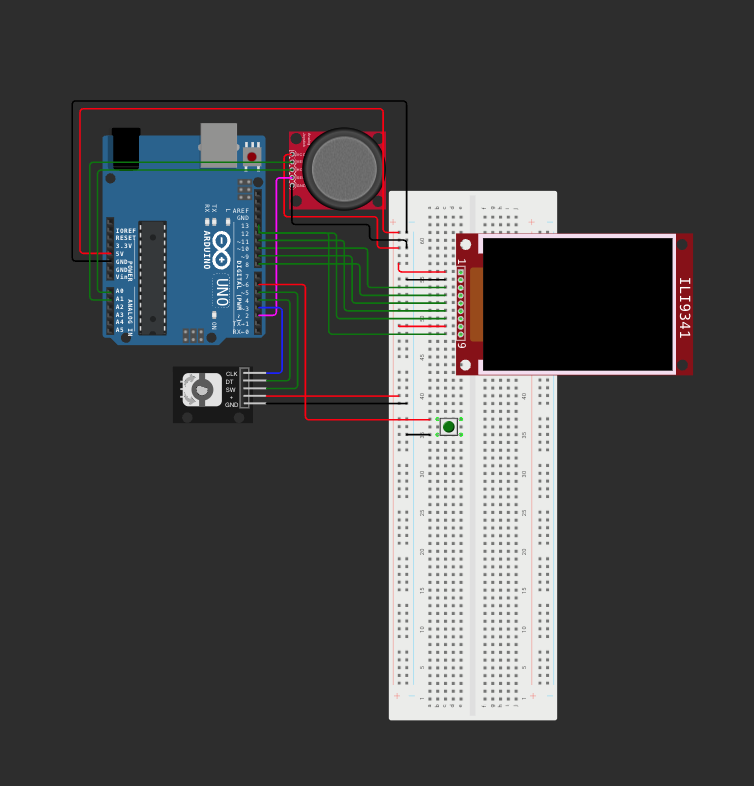

# Arduino TFT Arcade

A handheld-style arcade built with an Arduino Uno R3, a color TFT, an analog joystick, and a rotary encoder. The firmware includes **Snake**, **Space Shooter**, and **Brick Breaker**. The physical build uses a 1.8-inch ST7735S display with an encoder and two button inputs built into the display board.

## Hardware demos

The previews loop on this page. Each MP4 link downloads the full recording.

| Menu navigation | Snake | Space Shooter |
| --- | --- | --- |
|  |  |  |
| [Download menu video (MP4)](https://raw.githubusercontent.com/KhanhDo1609/Game_TFT_Screen/main/media/demos/menu.mp4) | [Download Snake video (MP4)](https://raw.githubusercontent.com/KhanhDo1609/Game_TFT_Screen/main/media/demos/snake.mp4) | [Download Space Shooter video (MP4)](https://raw.githubusercontent.com/KhanhDo1609/Game_TFT_Screen/main/media/demos/shooter.mp4) |

## Circuit and simulation

[Open the original Wokwi project](https://wokwi.com/projects/480010973403165697)

The shared Wokwi URL currently opens a 16×2 LCD circuit with an empty sketch. To try the TFT arcade shown above, open a [new Arduino Uno project in Wokwi](https://wokwi.com/projects/new/arduino-uno), copy in the [simulator sketch](wokwi/sketch.ino) and [circuit diagram](wokwi/diagram.json), and add the libraries listed in [libraries.txt](wokwi/libraries.txt). Then start the simulation. The simulator version uses an ILI9341 display, a separate KY-040 encoder, a Back button, and a piezo buzzer.

## Physical build

Use the [hardware sketch](Game_TFT_Screen_joystick/Game_TFT_Screen_joystick.ino) for the **1.8-inch ST7735S** module. It draws at **160 × 128** in landscape. The rotary encoder on that board replaces the separate encoder in the simulator. Pressing the knob triggers `PUSH`, and the separate button triggers `K0`.

### Parts

- Arduino Uno R3 and a USB cable
- 1.8-inch ST7735S SPI display module with a built-in EC11 encoder and K0 button
- Analog joystick module, breadboard, and jumper wires
- Five channels of 5 V-to-3.3 V logic level shifting for the TFT inputs
- Optional passive piezo buzzer for game sounds

### Uno wiring

| Part | Pin on module | Uno connection |
| --- | --- | --- |
| TFT | GND | GND |
| TFT | VCC | Regulated 3.3 V |
| TFT | SCL | D13 (SPI clock) through level shifter |
| TFT | SDA | D11 (SPI data) through level shifter |
| TFT | RES | D8 through level shifter |
| TFT | DC | D9 through level shifter |
| TFT | CS | D10 through level shifter |
| TFT | BLK | Leave open on the module with the default-on backlight |
| Built-in encoder | A, B | D3, D4 |
| Built-in controls | PUSH, K0 | D5, D6 |
| Joystick | GND, 5V | GND, 5V |
| Joystick | VRX, VRY, SW | A0, A1, D2 |
| Optional piezo | +, − | D7, GND |

The TFT labels `SCL` and `SDA` carry SPI signals. Share ground between the Uno, display, and level shifter. The Uno's 3.3 V output is rated for 50 mA total. If the display and other loads exceed that rating, use a separate regulated 3.3 V supply with common ground. The hardware sketch expects the module's controls to have pull-ups. If an input floats, add a 10 kΩ pull-up from that line to 3.3 V. [Uno pinout](https://content.arduino.cc/assets/A000066-full-pinout.pdf)

### Build and upload

1. In Arduino IDE's Library Manager, install **Adafruit ST7735 and ST7789 Library** and accept its dependencies, including **Adafruit GFX Library** and **Adafruit BusIO**.
2. Open `Game_TFT_Screen_joystick/Game_TFT_Screen_joystick.ino` and select **Arduino Uno** and its USB port.
3. Click **Verify**, then **Upload**. The sketch initializes the ST7735S with `INITR_BLACKTAB`.
4. If left and right are reversed on a different joystick mounting, adjust the `joyX` read in `loop()`. The supplied hardware sketch already inverts VRX for the orientation used in the demos.

## Controls

| Screen | What to do |
| --- | --- |
| Menu | Move the joystick up or down or turn the encoder. Press either the joystick or the encoder to select. |
| Snake | Steer with the joystick and collect food. |
| Space Shooter | Move left or right with the joystick and press it to fire. |
| Brick Breaker | Move the paddle left or right with the joystick. |
| Any game | Press K0 to return to the menu. After a game ends, press the joystick or encoder to retry. |

Flappy Bird, Racing, and YouTube Music are placeholders in the current menu.
